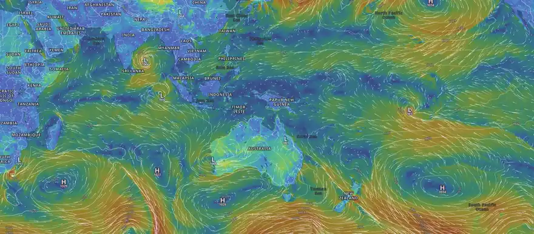
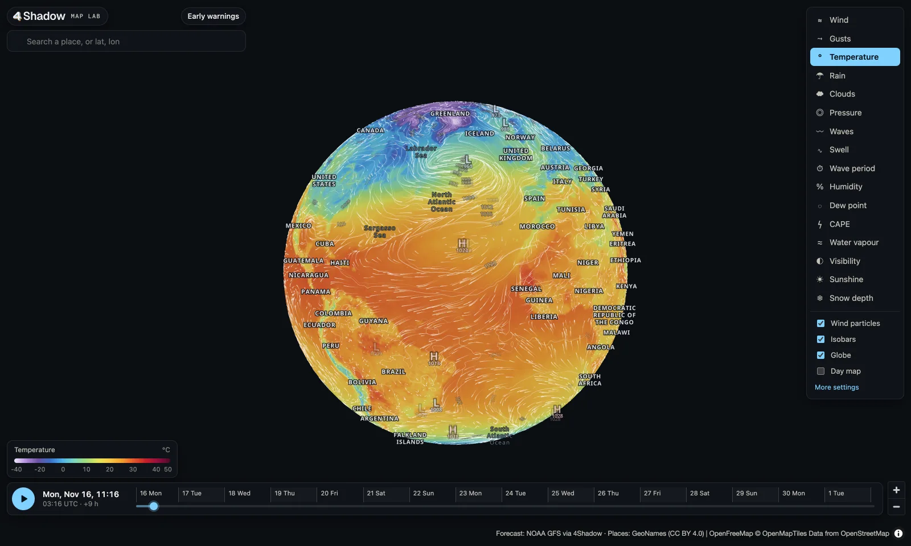
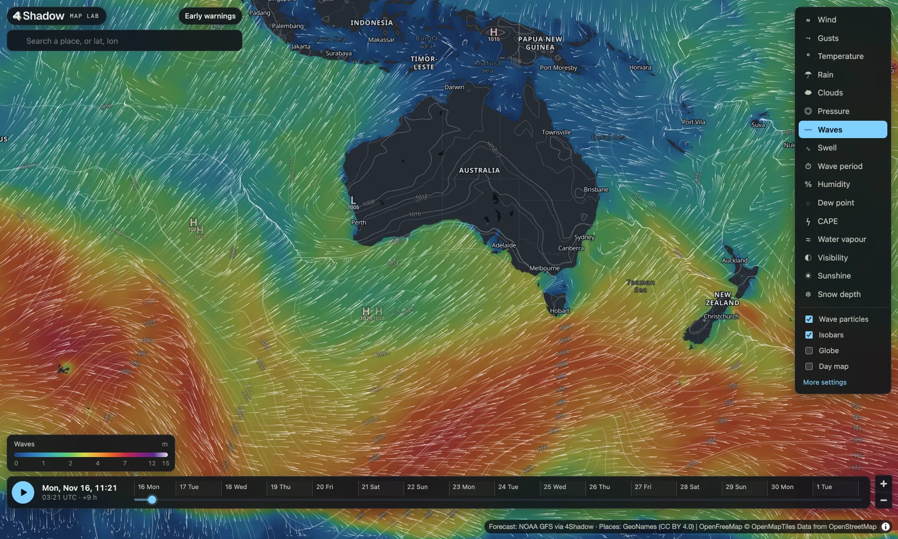
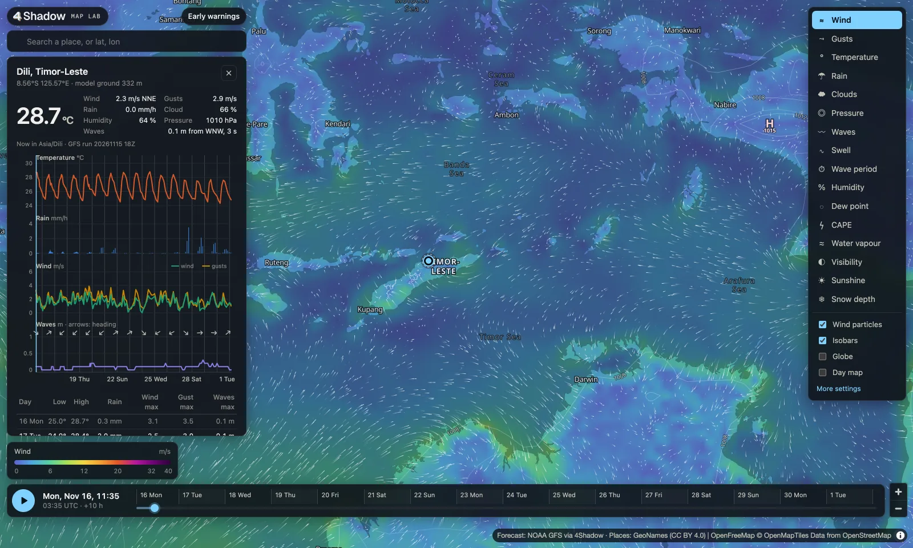
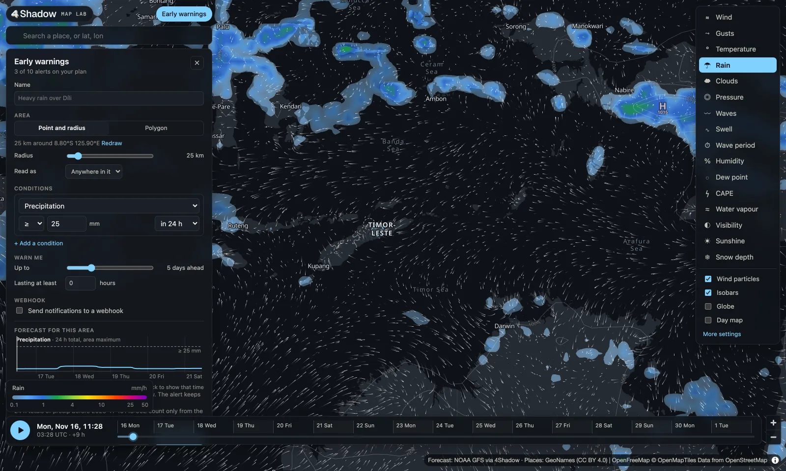
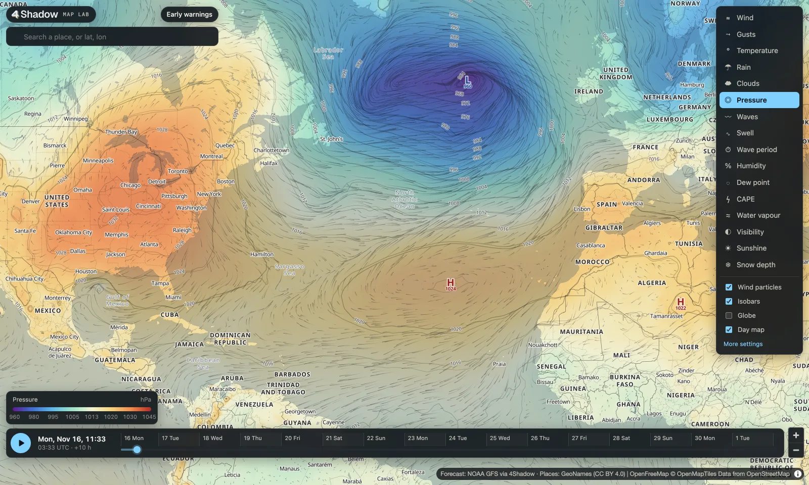
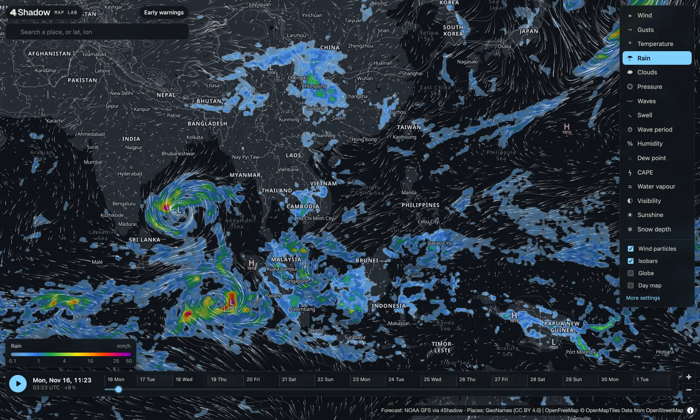
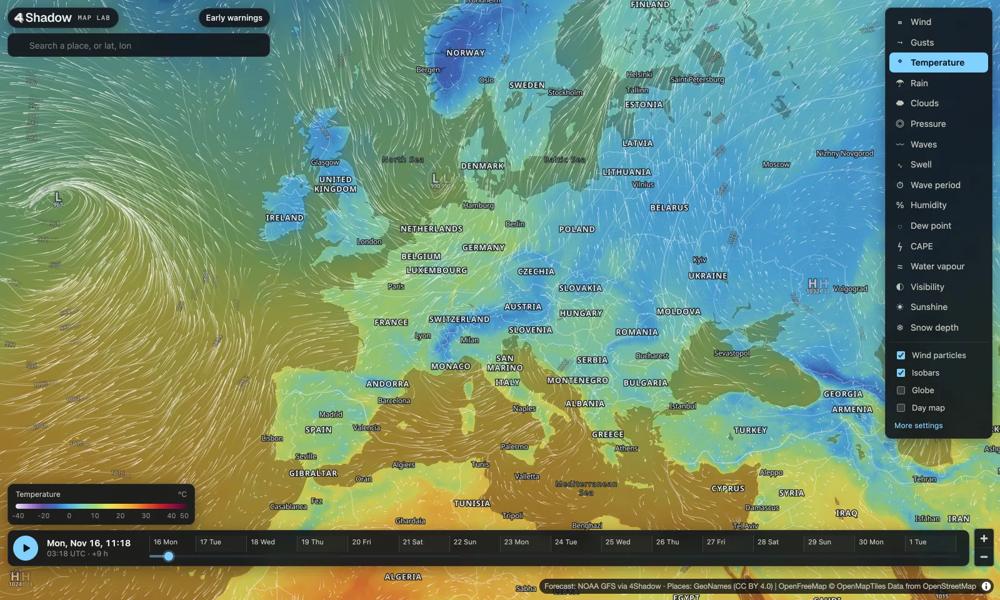
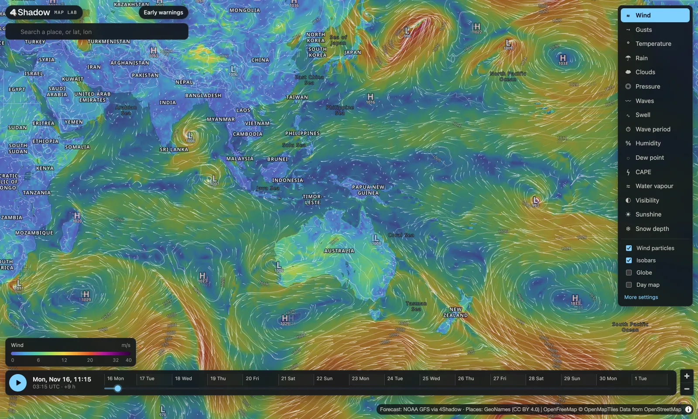
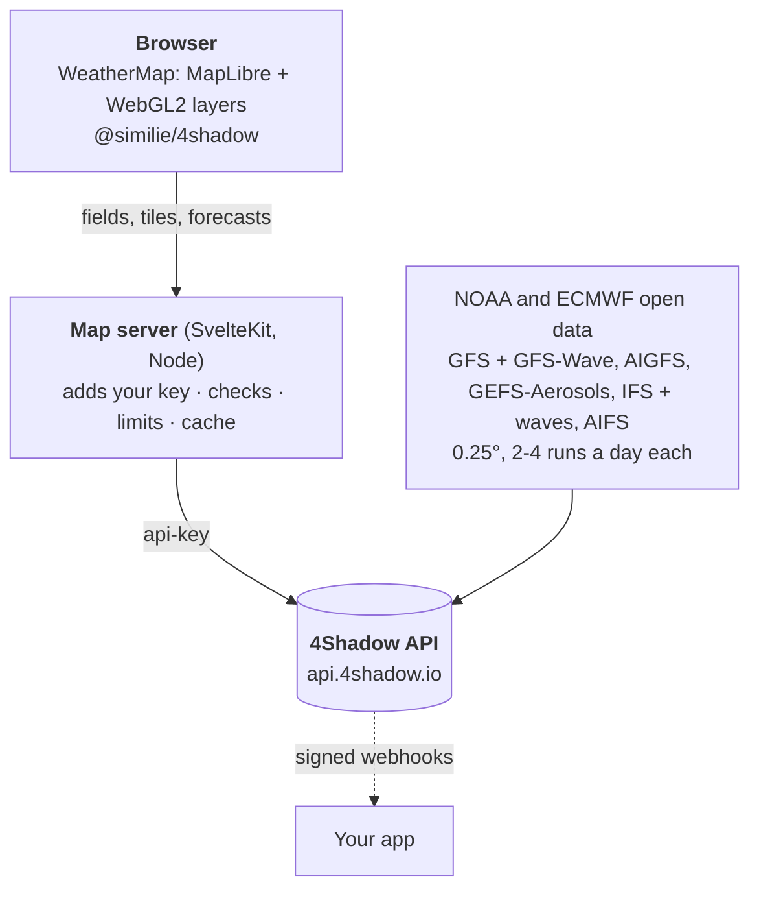

<p align="center">
  <a href="https://4shadow.io">
    <picture>
      <source media="(prefers-color-scheme: dark)" srcset="docs/images/wordmark-dark.svg" />
      
    </picture>
  </a>
</p>

<h3 align="center">Live weather maps and a forecast SDK for the whole planet</h3>

<p align="center">
  WebGL wind, rain, temperature, pressure and waves, 16 days ahead, on a map you can run, change and deploy.<br />
  Open source, built on the <a href="https://4shadow.io">4Shadow</a> forecast API.
</p>

<p align="center">
  <a href="https://github.com/similie/4Shadow-js/actions/workflows/ci.yml"></a>
  <a href="https://www.npmjs.com/package/@similie/4shadow"></a>
  <a href="LICENSE"></a>
  
  
  <a href="docs/deploy.md"></a>
</p>

<p align="center">
  <a href="https://4shadow.io/map"><b>Live map</b></a> ·
  <a href="https://4shadow.io/signup"><b>Get a free API key</b></a> ·
  <a href="https://4shadow.io/docs">API docs</a> ·
  <a href="docs/deploy.md">Deploy your own</a> ·
  <a href="packages/sdk">SDK</a>
</p>

<p align="center">
  
</p>

---

## What's in this repository

|                                    |                                                                                                                                                                                                                                        |
| ---------------------------------- | -------------------------------------------------------------------------------------------------------------------------------------------------------------------------------------------------------------------------------------- |
| [`packages/sdk`](packages/sdk)     | **`@similie/4shadow`**, the API client. Point forecasts by coordinates or place name, place search, map tiles, raw gridded fields for WebGL, early-warning alerts and webhook verification. Typed, no dependencies, Node and browsers. |
| [`apps/map-lab`](apps/map-lab)     | **The map.** A SvelteKit app that draws the forecast on the GPU: 31 colour layers, wind and wave particles, isobars, a globe, smooth time, point forecasts and early warnings. Run it locally, or deploy it as a public map.           |
| [`docs/deploy.md`](docs/deploy.md) | **Deploy guide.** Docker or Node, settings, reverse proxies, and what a public map costs.                                                                                                                                              |

## Highlights

- **Drawn on the GPU from raw data.** The map fetches the forecast as compact gridded fields (int16; wind for the whole globe at 0.5° is about 1 MB) and colours them in a fragment shader, smooth between grid points and between hours. No pre-rendered images, no blocky tiles.
- **Particles that follow the weather.** Up to 65,536 particles move with the 10 m wind or, on the wave layers, with the waves at their group speed, so long swell visibly outruns short wind waves. Positions update on the GPU with WebGL2 transform feedback.
- **Sharp at every zoom.** The whole world loads at 0.5°; from zoom 3 the area in view also loads at the model's full 0.25° and is drawn over it.
- **Smooth time.** Press play and 16 days of forecast run without a jump: colours and particles blend between steps, and isobars and pressure centres crossfade. Data loads ahead of the playhead.
- **Flat map or globe, night or day.** Both basemaps are vector tiles, with the weather under coastlines, borders and labels.
- **Four weather models and air quality.** Switch between NOAA's GFS and its AI model AIGFS, and ECMWF's IFS and AIFS, and lay air quality (PM2.5, PM10, dust and smoke haze, from NOAA's GEFS-Aerosols) over any of them. The map offers the models your key's plan includes.
- **Point forecasts.** Click anywhere for current conditions, a meteogram (temperature, rain, wind and gusts, waves at sea) and daily and hourly tables, in the place's own time zone.
- **Early warnings.** Draw an area, set conditions like "50 mm of rain in 24 hours", see at once which hours of the latest forecast meet them, and get signed webhooks and emails when a new run does.
- **Deploy it in one command.** Public mode keeps your API key on your server, forwards only what the map draws, caches each field once per forecast run for all visitors, and limits each visitor.

## Gallery

<table>
  <tr>
    <td width="50%"><br /><sub><b>Globe.</b> Temperature with wind particles and pressure centres.</sub></td>
    <td width="50%"><br /><sub><b>Waves.</b> Wave height; particles travel with the waves at their group speed.</sub></td>
  </tr>
  <tr>
    <td><br /><sub><b>Point forecast.</b> Click anywhere: current conditions, meteogram, daily table.</sub></td>
    <td><br /><sub><b>Early warnings.</b> Draw an area, set conditions, preview them against the latest run.</sub></td>
  </tr>
  <tr>
    <td><br /><sub><b>Day map.</b> Sea-level pressure, isobars every 4 hPa, highs and lows.</sub></td>
    <td><br /><sub><b>Rain.</b> Precipitation rate over Southeast Asia.</sub></td>
  </tr>
  <tr>
    <td><br /><sub><b>Temperature.</b> 2 m temperature over Europe at the model's full 0.25°.</sub></td>
    <td><br /><sub><b>Wind.</b> 10 m wind with particles, isobars and the layer list.</sub></td>
  </tr>
</table>

Every image is real output from the map, taken with [`apps/map-lab/scripts/screenshots.mjs`](apps/map-lab/scripts/screenshots.mjs).

## Quick start

### The SDK

```sh
npm install @similie/4shadow
```

```ts
import { ForeshadowClient, dailyRows } from "@similie/4shadow";

const fs = new ForeshadowClient({ apiKey: process.env.FORESHADOW_API_KEY });

// By place name or by coordinates; the response says which place it used.
const dili = await fs.forecast("Dili, Timor-Leste", { hours: 48 });
console.log(dili.location.place?.display_name, dili.current?.t2m, "°C");

// Daily summaries in the place's own time zone.
for (const day of dailyRows(dili)) console.log(day.date, day.t2m_min, day.t2m_max, day.precip_sum);

// A field for your own WebGL layer: wind at forecast hour 6, the whole globe at 0.5°.
const wind = await fs.field({ vars: ["u10", "v10"], time: 6, stride: 2 });
```

The [SDK README](packages/sdk) covers sea state, places, tiles, fields and colour palettes, early warnings and webhooks, and errors.

### The map

You need Node 22.17+ and an API key ([free at 4shadow.io](https://4shadow.io/signup)).

```sh
git clone https://github.com/similie/4Shadow-js.git && cd 4Shadow-js
npm install
cp apps/map-lab/.env.example apps/map-lab/.env.local   # set FORESHADOW_API_KEY
npm run lab                                             # http://localhost:5181
```

The browser talks only to the lab's own server, which adds your key. The [map lab README](apps/map-lab) explains the layers, the early-warning rig and how the code is laid out.

### Your own public map

```sh
docker build -f apps/map-lab/Dockerfile -t 4shadow-map .
docker run -p 3000:3000 -e FORESHADOW_API_KEY=your-key 4shadow-map   # http://localhost:3000
```

Anyone can view it; your key stays on the server, and early warnings are off. The [deploy guide](docs/deploy.md) covers proxies, settings and what it costs.

## How it works



- **Fields** are the forecast on the model grid, up to four variables per request, as int16 arrays behind a JSON header (`4SF1`). The SDK decodes them; the map uploads them as float textures and samples them in shaders with the API's own legend colours, so the WebGL layers match the API's PNG tiles.
- **The map engine** (`apps/map-lab/src/lib/weather/`) has no Svelte in it: one `WeatherMap` class owns a MapLibre map and its custom layers, ready to become its own package.
- **The server** in front of the API keeps the key out of the browser. Locally it is the full lab; in public mode it is a narrow, cached, rate-limited door.

## Data and credits

- **Forecasts:** NOAA's [Global Forecast System](https://www.ncei.noaa.gov/products/weather-climate-models/global-forecast) and GFS-Wave (public domain), served by [4Shadow](https://4shadow.io): 45 variables at 0.25° worldwide, heat, fire and comfort indices among them, hourly for 5 days and 3-hourly to 16 days, four runs a day. Also NOAA's AI model, AIGFS (public domain; built on Google DeepMind's GraphCast), 6-hourly to 16 days, and air quality from NOAA's GEFS-Aerosols (public domain), 3-hourly to 5 days.
- **ECMWF's IFS and AIFS:** © European Centre for Medium-Range Weather Forecasts (ECMWF), [open data](https://www.ecmwf.int/en/forecasts/datasets/open-data) under [CC BY 4.0](https://creativecommons.org/licenses/by/4.0/), served by 4Shadow at 0.25°: IFS, the European model, with waves, 3-hourly to 6 days and 6-hourly to 15 days; AIFS, ECMWF's AI model, 6-hourly to 15 days. The map credits ECMWF whenever a layer shows its data.
- **Place names:** [GeoNames](https://www.geonames.org), CC BY 4.0.
- **Basemap:** [OpenFreeMap](https://openfreemap.org), © [OpenMapTiles](https://openmaptiles.org), © [OpenStreetMap](https://www.openstreetmap.org/copyright) contributors.
- **Built with:** [MapLibre GL JS](https://maplibre.org), [d3-contour](https://github.com/d3/d3-contour), [SvelteKit](https://svelte.dev).

## Roadmap

- `@similie/4shadow-map`: the map engine as a package for any MapLibre app.
- Respect reduced motion: still streamlines in place of moving particles.
- Move the coastline wave spreading into a worker, so playback never waits on it.
- Ensembles as the 4Shadow API adds them (GEFS, ECMWF ENS, AIGEFS), for the chance of an event.

Ideas and votes are welcome in [issues](https://github.com/similie/4Shadow-js/issues).

## Contributing

Bug reports, ideas and pull requests are welcome. [CONTRIBUTING.md](CONTRIBUTING.md) has the setup and the checks CI runs: formatting, types, tests on Node 22, 24 and 26, both builds and the Docker image. Please follow the [code of conduct](CODE_OF_CONDUCT.md), and report security problems privately as [SECURITY.md](SECURITY.md) describes.

## License

[MIT](LICENSE) © [Similie](https://similie.com). The forecast API itself is a hosted service with its own [terms](https://4shadow.io/terms).

<p align="center">
  <a href="https://4shadow.io/signup"><b>Get your free API key</b></a> and put live weather on your own map.
</p>
