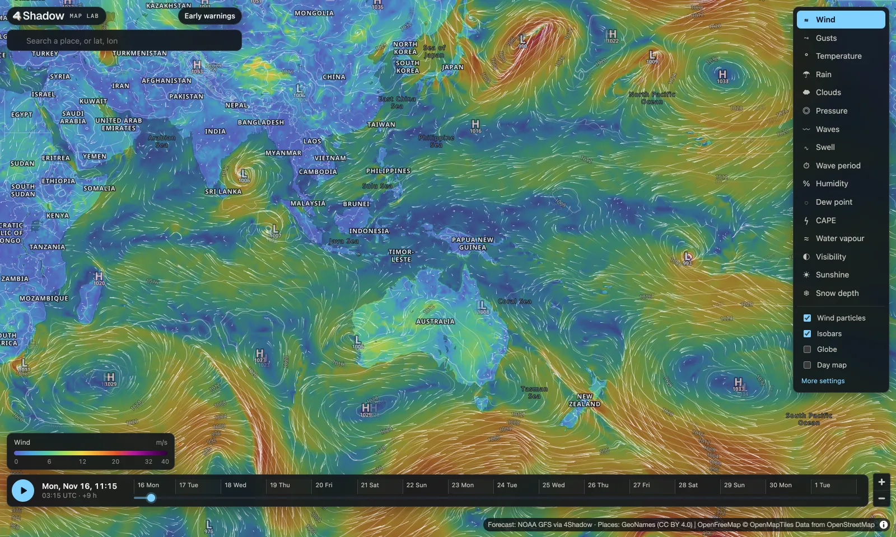

# 4Shadow map lab

A SvelteKit app that draws live weather maps from the 4Shadow API's raw fields. Run it locally as a lab for building maps and early warnings, or [deploy it](../../docs/deploy.md) as a public weather map.



- **Colour layers on the GPU** for wind (at 10 m and at 100 m, the height of wind turbines), gusts, temperature, rain, radar reflectivity, clouds and low clouds, pressure, waves, swell, wave period, feels-like temperature, heat index, wet-bulb temperature, fire weather, dryness (VPD), humidity, dew point, CAPE, water vapour, visibility, sunshine, snow depth, freezing level and soil moisture, and air quality (PM2.5, PM10, dust, smoke haze, haze). The colours are the API's own legends, so they match the server's PNG tiles. They are smooth between grid points.
- **Animated particles**, moved on the GPU and leaving fading trails. They follow the wind, or on the wave layers, the waves: toward where the waves are heading, at their group speed (about 0.78 m/s per second of period), so long swell outruns short wind waves.
- **Sharp when zoomed in.** The whole world loads at 0.5°. From zoom 3, the area in view also loads at the full 0.25° and is drawn over it.
- **Waves follow the real coastline.** The wave model's land mask is coarse (0.25° cells), so wave values are spread two cells toward the coast and then clipped to the basemap's water. Fire weather, which means nothing over water, is clipped to the basemap's land the same way.
- **Every model the API serves.** The lab asks the API's health which models have a run and offers those your key may call (on api.4shadow.io each model is on some plans; one your plan doesn't include answers 403 and isn't shown). Weather models, such as NOAA's AI model AIGFS (built on Google DeepMind's GraphCast) or ECMWF's IFS and AIFS where the API has them, go in a switch at the top of the layer list, and the list shows only the layers the chosen model has. The point panel follows the switch.
- **Air quality over the weather.** A model without wind of its own, such as NOAA's GEFS-Aerosols, adds its layers to the list instead: PM2.5, PM10, dust, smoke haze and haze. They draw over the chosen weather model's wind particles and isobars, and stay blank outside the air-quality run's 5 days.
- **Credit where the licence asks for it.** The map's attribution names the forecast models in view, in ECMWF's own words for its data (CC BY 4.0).
- **Isobars** with labels, and **high/low pressure centres**.
- **Smooth time.** The colour layers and particles blend their values between forecast steps. Isobars, H/L centres and the server's tiles can't be blended that way, so each has two copies, one for the step before and one for the step after, crossfaded as time moves. A copy gets the next step's data only while it is invisible, so nothing jumps. Data is fetched four steps ahead (past the end, too, since playback loops); the isobars for those steps are computed in a worker as their data arrives. Playback waits for all of it, keeping the last full picture meanwhile, and never skips.
- **Flat map or globe**, on a **night or day basemap**.
- **Click for a point forecast**: current conditions (with waves at sea), a meteogram with a wave row at sea (click an hour to show it on the map), daily and hourly tables.
- **Place search** with GeoNames names, or type `lat, lon`.
- **Server tiles** setting: shows the server's PNG tiles in place of the WebGL layer, to compare the two.
- **Early warnings.** Draw an area (a point and radius, or a polygon), set conditions such as 50 mm of rain in 24 hours, and see at once what the latest forecast says for it: a chart per condition, with the hours that meet it. Save it and its events show on the map (filled while on at the map's time, outlined while still to come) and on the timeline. Each alert shows its webhook deliveries, and the webhooks the lab itself received, with their signatures checked.

## Run it

You need a 4Shadow API key: get one at [4shadow.io](https://4shadow.io). Copy `.env.example` to `apps/map-lab/.env.local` (git-ignored) and set `FORESHADOW_API_KEY`. Then, from the root of this repo:

```sh
npm install
npm run lab        # http://localhost:5181
```

The browser talks only to the lab's own server, which adds your key and passes the request on to `https://api.4shadow.io`. The key never reaches the browser.

To receive your alerts' webhooks, run a tunnel next to the lab (it needs [cloudflared](https://developers.cloudflare.com/cloudflare-one/connections/connect-networks/downloads/)):

```sh
npm run tunnel     # prints https://….trycloudflare.com/hooks/4shadow
```

New alerts in the lab send their webhooks there. To use ngrok or another tunnel instead, set `WEBHOOK_URL` in `.env.local` to its address plus `/hooks/4shadow`.

To have the browser call an API directly instead of through the lab's server, set `VITE_FORESHADOW_URL`; see `.env.example`.

Keys: <kbd>Space</kbd> plays and pauses, <kbd>←</kbd>/<kbd>→</kbd> move an hour (with <kbd>Shift</kbd>, a day), <kbd>Esc</kbd> closes the panels. While drawing an area: <kbd>Enter</kbd> closes the polygon, <kbd>Backspace</kbd> removes the last corner, <kbd>Esc</kbd> stops. The map position is kept in the URL.

## Deploy it as a public map

Set `MAP_MODE=public` and anyone can view the map, while your key stays on the server:

```sh
docker build -f apps/map-lab/Dockerfile -t 4shadow-map .     # from the repository root
docker run -p 3000:3000 -e FORESHADOW_API_KEY=your-key 4shadow-map
```

In public mode the server (`src/lib/server/public-map.ts`) forwards only the requests the map makes, with their parameters checked; it limits each visitor and all visitors together, and keeps fields and tiles in a shared memory cache, so each is fetched from 4Shadow once per forecast run. Early warnings and the webhook rig are off, and the page offers "Get a free API key" in their place. The [deploy guide](../../docs/deploy.md) has the settings, a reverse proxy setup and what it costs.

## Early warnings, end to end

```
browser ── /api/4shadow/v2/… ──▶ lab server ── + api-key ──▶ api.4shadow.io
                                     ▲                            │ webhook, signed
browser ◀── /api/rig/feed (SSE) ─────┤                            ▼
                                     └── POST /hooks/4shadow ◀── tunnel
```

- **The proxy** (`src/routes/api/4shadow/[...path]`) passes `v2/` requests on with your key. When an alert response carries a webhook secret (shown once: on create, on a new secret, or when a webhook is added), it keeps a copy in `.rig/secrets.json` so the receiver can check signatures; deleting the alert drops it.
- **The receiver** (`src/routes/hooks/4shadow`) checks each delivery with the SDK's `verifyWebhook()` and answers 204, or 400 when the signature is wrong. Retries of one notification share a `webhook-id`, so a repeat shows as a retry.
- **The feed** (`src/routes/api/rig/feed`) streams what the receiver saw to the page, which refreshes the alerts and events when one arrives.
- **Through the tunnel, only the receiver answers.** Every other path, the proxy above all, answers only requests from this machine (`src/lib/server/local-only.ts`, used by both the dev server and `npm start`).

In your own app the receiver is the part to copy: read the raw body, look up the alert's secret, call `verifyWebhook()`, answer 2xx quickly and do the work afterwards.

## How it's built

`src/lib/weather/` holds the map code. It uses no Svelte, so it can move into an SDK map package later:

| File                                  | What it does                                                                                                                                                                                                                                                                                                                                                                                                                                                                                                                                         |
| ------------------------------------- | ---------------------------------------------------------------------------------------------------------------------------------------------------------------------------------------------------------------------------------------------------------------------------------------------------------------------------------------------------------------------------------------------------------------------------------------------------------------------------------------------------------------------------------------------------- |
| `weather-map.ts`                      | Owns the MapLibre map. Turns time and settings into data requests and layer updates; handles playback and the hover readout.                                                                                                                                                                                                                                                                                                                                                                                                                         |
| `field-layer.ts`                      | MapLibre custom layer. Draws a field's values as colours. Float textures are sampled bilinearly in the shader, with the legend's stops as uniforms. Blends two steps, and uses a finer regional field where it has one. Works in mercator (all world copies) and on the globe. It also paints the land: the basemap's background is transparent, so sea-only layers can draw only where water is (`DST_ALPHA` blending), land-only layers only where it isn't ("under" blending), and the land colour then goes under whatever is still transparent. |
| `particle-layer.ts`                   | Particles for any vector field (wind, or wave motion). Positions are updated with WebGL2 transform feedback. Each move is drawn as an anti-aliased segment into a trail texture that fades every frame. Particles end where the field has no data (land, for waves). Trails reset while the map moves.                                                                                                                                                                                                                                               |
| `wave-flow.ts`                        | Turns wave direction and period into a vector field for the particles.                                                                                                                                                                                                                                                                                                                                                                                                                                                                               |
| `crossfade.ts`                        | Two copies of a per-step overlay (isobars, server tiles), crossfaded between steps.                                                                                                                                                                                                                                                                                                                                                                                                                                                                  |
| `isobar-jobs.ts`, `isobars.worker.ts` | Computes each step's isobars in a worker (about 30 ms per step, which made playback stutter on the main thread), cached per field.                                                                                                                                                                                                                                                                                                                                                                                                                   |
| `isobars.ts`                          | Isobars every 4 hPa (d3-contour on a 1° pressure field, smoothed), plus H/L centres.                                                                                                                                                                                                                                                                                                                                                                                                                                                                 |
| `cache.ts`                            | Fetched fields (global, or a `bbox` at full resolution), shared between layers, with prefetching and a size limit.                                                                                                                                                                                                                                                                                                                                                                                                                                   |
| `gl.ts`                               | Shader helpers: MapLibre's projection prelude, grid sampling in GLSL, float textures.                                                                                                                                                                                                                                                                                                                                                                                                                                                                |
| `basemap.ts`                          | Night and day basemaps on OpenFreeMap vector tiles. Weather sits under coasts, borders and labels.                                                                                                                                                                                                                                                                                                                                                                                                                                                   |

`src/lib/alerts/` holds the early-warning code:

| File              | What it does                                                                                        |
| ----------------- | --------------------------------------------------------------------------------------------------- |
| `alert-layers.ts` | Alerts on the map, without Svelte: areas, events by the map's time, and drawing a point or polygon. |
| `geo.ts`          | Circles on the globe, areas and their sizes, and alerts in words ("Precipitation ≥ 50 mm in 24 h"). |
| `store.svelte.ts` | Your alerts, their events and the webhooks received, shared by the panel, map and timeline.         |

The panels are in `src/lib/components/alerts/`: `AlertsPanel` (list and detail), `AlertEditor` (draw, set conditions, preview, save) and `PreviewChart`.

The app uses the SDK's TypeScript source (the `source` export condition), so SDK changes show up here without a rebuild.

`src/lib/server/` holds the server side: `local-only.ts` (who may use the lab's server) and `public-map.ts` (the door for public mode).

## Tests and screenshots

```sh
npm test -w apps/map-lab          # unit tests (vitest): the public door, the local-only guard, alert geometry,
                                  # wave motion, isobars and H/L centres, readouts, the layer catalog
npm run screenshots               # from the repo root, with the lab running: retakes docs/images
```

The screenshots script drives headless Chrome over the DevTools protocol (no extra packages) and needs `ffmpeg` and `img2webp` for the animation. The images are whatever the latest forecast run shows.

## Data use

Through the proxy, the map's requests use your key and count against your plan, like any other API use.

A global field at 0.25° is about 2 MB per variable per step: wind (u + v) is about 4 MB, and the 1° pressure field for isobars is about 130 KB. The lab loads the world at 0.5° (a quarter of that) and, from zoom 3, the area in view at 0.25°: at zoom 4 on a large screen, about 0.4 MB of wind per step. Change the world grid under _More settings → Global grid_; at 0.25° there is no separate detail.

## Known gaps

- Rain and some other GFS fields look blocky at the coast. That comes from the data; the server tiles show the same.
- GFS-Wave's global grid leaves out the Black and Caspian Seas, so they have no waves.
- Lakes within about 50 km of the sea pick up the spread sea values.
- Particles move at a constant screen speed per m/s, not at true ground speed, so they read the same at every zoom.
- Spreading wave values toward the coast runs on the main thread, so a frame can take up to ~50 ms when a new step arrives during playback. A worker would fix that.

## Credits

Forecasts: NOAA GFS. Place names: GeoNames (CC BY 4.0). Basemap: OpenFreeMap, © OpenMapTiles, © OpenStreetMap contributors.
